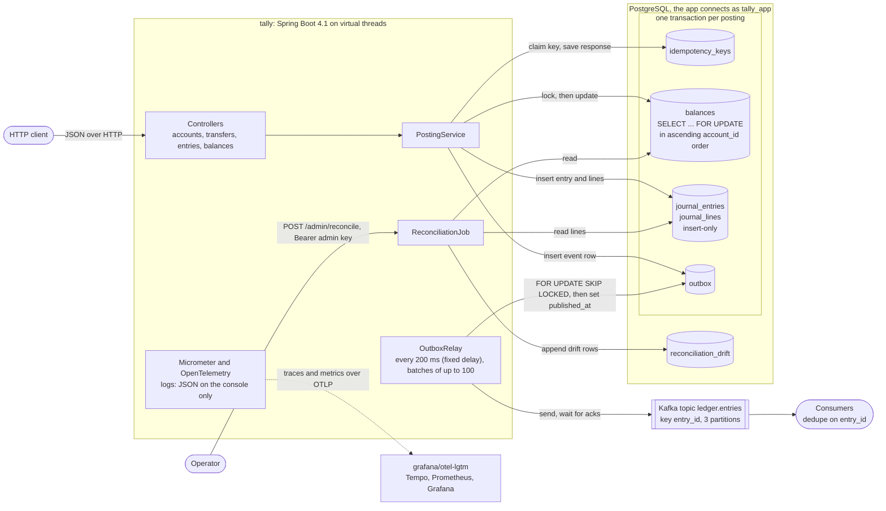

# tally

tally is a double-entry ledger service in Java 25 and Spring Boot 4.1. Every money movement is a balanced journal entry, and entries are only ever appended: a mistake is undone by a reversal entry, never by an edit. A retried request with the same `Idempotency-Key` moves money once. Every committed entry is published to Kafka as it was saved, through a transactional outbox. A recount job compares every stored balance with the sum of its lines and reports drift without fixing it. Tests run against real PostgreSQL and Kafka through Testcontainers, including runs where the database link is cut or slowed or Kafka is cut, and a script kills the app mid-run; afterwards they check that no money moved twice and every balance still equals its lines.

## Architecture



- Packages by feature under `dev.jenishsoni.tally`: `common`, `account`, `posting`, `balance`, `idempotency`, `outbox`, `reconcile`. A feature's controller, service and repository live in its package, and no feature calls another feature's repository: posting goes through `AccountService`, `BalanceService`, `IdempotencyStore` and `OutboxWriter`. The recount reads `balances` and `journal_lines` with its own SQL on purpose, so it stays independent of the code it checks.
- The database is the source of truth and Kafka is a copy of what committed. The outbox row is written in the posting transaction, so an event exists exactly when its entry committed. The relay publishes it afterwards and marks it published only once Kafka has acknowledged it. Delivery is at least once, consumers dedupe on `entry_id`, and Kafka orders messages per entry, not per account ([docs/design.md](docs/design.md)).
- A posting is one transaction that follows the recipe in [PostingService.java](src/main/java/dev/jenishsoni/tally/posting/PostingService.java): validate, claim the idempotency key, lock the touched balance rows with `SELECT ... FOR UPDATE` in ascending `account_id` order, check that no account that disallows negative balances goes below zero, insert the entry and its lines, update the balances, insert the outbox row, save the response, commit. Bean Validation runs before the claim; the service's own checks (the entry balances, its accounts exist and hold its currencies) run after it, so a key reused for a different request is a 409 even when that request would also be refused with a 422 or 404.
- A transfer can first ask the risk engine, a separate service, whether it may go ahead. The check is off by default. The call is made before the posting transaction opens, so tally holds no transaction, row lock or pooled connection while it waits ([docs/risk-decision-call.md](docs/risk-decision-call.md), [ADR 0007](docs/adr/0007-risk-call-before-the-posting-transaction.md)).
- Every entry sums to zero per currency, checked in code and again at commit by a deferred constraint trigger. A second deferred trigger refuses an entry with no lines, and a composite foreign key keeps each line in its account's currency ([V2__journal.sql](src/main/resources/db/migration/V2__journal.sql)).
- Money is a `long` count of cents plus a 3-letter currency code. Arithmetic uses `Math.addExact` and `Math.negateExact`, so an overflow is refused with a 422 instead of wrapping around ([Money.java](src/main/java/dev/jenishsoni/tally/common/Money.java)).
- The app connects as `tally_app`, which has SELECT and INSERT on the journal tables and no UPDATE or DELETE ([V3__app_role.sql](src/main/resources/db/migration/V3__app_role.sql)). Flyway runs as the schema owner.
- Traces and metrics go over OTLP to grafana/otel-lgtm. Log lines are JSON on the console with `traceId`, `spanId`, `entry_id` and `idempotency_key`; they are not sent to Loki (an open decision in [PROGRESS.md](PROGRESS.md)).

## Run it

You need:

- JDK 25. The build asks Gradle for a Java 25 toolchain and has no toolchain resolver in `settings.gradle.kts`, so Gradle does not download one: JDK 25 must already be installed where Gradle finds it, for example as `JAVA_HOME`. PLAN.md suggests Eclipse Temurin 25.
- Docker, running. On macOS, if you clone into a privacy-protected folder such as Desktop, Docker needs access to that folder, because `compose.yaml` mounts the Grafana dashboard from `ops/grafana/`.
- Free local ports 5432, 9092, 9094, 3000, 4317 and 4318 for the Compose stack, and 8080 for the app. 9094 is Kafka's second listener, for containers of other Compose projects.
- `curl`, `jq` and `openssl` for the examples below.

```sh
./gradlew bootRun
```

That is the one command. Spring Boot's Docker Compose support starts `compose.yaml`: postgres:18.6, apache/kafka:4.3.1 (one KRaft node) and grafana/otel-lgtm:0.37.0, all bound to 127.0.0.1. Flyway migrates the schema as the owner. The API then answers on http://localhost:8080, and Grafana on http://localhost:3000 has the "tally ledger" dashboard. In a fresh local clone on 2026-10-28 (Apple M4, Docker images already pulled, an empty Gradle cache, so Gradle and every dependency were downloaded), the health endpoint answered UP 66 s after the clone started, and the app logged `Started TallyApplication in 33.798 seconds`. A first run also pulls the images; `docker images` lists them at 3.49 GB (grafana/otel-lgtm), 690 MB (apache/kafka) and 672 MB (postgres) on disk, and how long the pull takes depends on the network. Ctrl+C stops the app, and Spring Boot then stops the three containers if it started them (a stack that was already running when the app started is left running); the containers and the database volume are kept for the next run, and `docker compose down -v` removes them.

The admin endpoints (`/admin/*`) need `TALLY_ADMIN_API_KEY` set to at least 32 characters. While it is unset, the app starts but refuses every admin request with 401; a shorter key stops the app at startup. To try the recount at the end of the examples, start the app with a throwaway key instead:

```sh
export TALLY_ADMIN_API_KEY=$(openssl rand -hex 32)
echo "$TALLY_ADMIN_API_KEY"   # paste it into the terminal where you run the examples
./gradlew bootRun
```

Every credential in `compose.yaml` and `application.yaml` is a throwaway local default, which the environment variable named next to it overrides. The database passwords take effect only on a new database volume: PostgreSQL applies `POSTGRES_PASSWORD` when it creates its data directory, and `V3__app_role.sql` sets the `tally_app` password (`DATABASE_PASSWORD`) only when it creates the role. So set them before the first run, or after `docker compose down -v`, and keep `POSTGRES_USER` and `POSTGRES_PASSWORD` equal to `DATABASE_OWNER_USER` and `DATABASE_OWNER_PASSWORD`, which Flyway connects with.

Tests:

- `./gradlew build`: compiles and runs every test except the simulation, against PostgreSQL, Kafka, Toxiproxy and otel-lgtm containers that Testcontainers starts, so Docker must be running. CI runs the same command on every pull request.
- `./gradlew test --tests '<ClassName>'`: one test class, for example `./gradlew test --tests 'ConcurrencyIT'`.
- `./gradlew simulationTest`: the random simulation, which sends each operation to the HTTP API and to an in-memory model and compares them. It runs 20 seeds of 500 operations by default; `-Dseed=<n>` replays one seed and `-Dseeds=<n>` sets how many run.
- `scripts/load.sh` runs load scenarios A and B, and `scripts/load.sh saturation` runs scenario A at a series of fixed virtual-user counts. It needs Docker, k6, jq and curl. It builds the jar and starts its own Compose project, `tally-load`, on the same ports as the `bootRun` stack, so stop `bootRun` first. Every run starts on a new stack with an empty database, and the results go to `load/results/<date>/`. The last run's stack is left running for a look in Grafana; `docker compose -p tally-load down -v` removes it.
- `scripts/crash-test.sh`: starts the jar, runs transfers whose keys come from the iteration number, kills the app with `kill -9` mid-run, restarts it, replays the same iterations, runs the recount and prints the drift count. It needs Docker, k6, curl, jq and openssl, uses the `compose.yaml` stack and port 8080, and stops if something already answers there. It makes its own throwaway admin key.

## Try it

Run these in a second terminal, in order, while `./gradlew bootRun` is up. Only the last one needs the admin key: first run `export TALLY_ADMIN_API_KEY=<the key printed in the first terminal>` here. Amounts are integer cents.

```sh
# A suffix for this run: account codes and idempotency keys are unique and never expire.
RUN=$(date +%s)

# New accounts start at 0, and an account that disallows negative balances cannot be overdrawn,
# so money comes from a funding account that may go negative.
FUNDING=$(curl -s -X POST localhost:8080/accounts -H 'Content-Type: application/json' \
  -d "{\"code\":\"funding-$RUN\",\"currency\":\"CAD\",\"allowNegative\":true}" | jq -r .id)
ALICE=$(curl -s -X POST localhost:8080/accounts -H 'Content-Type: application/json' \
  -d "{\"code\":\"alice-$RUN\",\"currency\":\"CAD\"}" | jq -r .id)
BOB=$(curl -s -X POST localhost:8080/accounts -H 'Content-Type: application/json' \
  -d "{\"code\":\"bob-$RUN\",\"currency\":\"CAD\"}" | jq -r .id)

# Fund Alice, and keep the entry's createdAt for the asOf read below.
FUNDED_AT=$(curl -s -X POST localhost:8080/transfers -H 'Content-Type: application/json' \
  -H "Idempotency-Key: fund-$RUN" \
  -d "{\"fromAccountId\":\"$FUNDING\",\"toAccountId\":\"$ALICE\",\"amount\":10000,\"currency\":\"CAD\"}" \
  | jq -r .createdAt)

# Alice pays Bob.
PAY_BODY="{\"fromAccountId\":\"$ALICE\",\"toAccountId\":\"$BOB\",\"amount\":2500,\"currency\":\"CAD\",\"description\":\"dinner\"}"
curl -s -X POST localhost:8080/transfers -H 'Content-Type: application/json' \
  -H "Idempotency-Key: pay-$RUN" -d "$PAY_BODY" | jq .

# The same request with the same key replays the saved response: same entry id, no second entry.
curl -s -X POST localhost:8080/transfers -H 'Content-Type: application/json' \
  -H "Idempotency-Key: pay-$RUN" -d "$PAY_BODY" | jq .
curl -s "localhost:8080/accounts/$BOB/entries?limit=10" | jq .

# The same key with a different amount: 409.
curl -s -X POST localhost:8080/transfers -H 'Content-Type: application/json' \
  -H "Idempotency-Key: pay-$RUN" \
  -d "{\"fromAccountId\":\"$ALICE\",\"toAccountId\":\"$BOB\",\"amount\":9900,\"currency\":\"CAD\",\"description\":\"dinner\"}" | jq .

# More than Alice has: 422, and the key stays unused.
curl -s -X POST localhost:8080/transfers -H 'Content-Type: application/json' \
  -H "Idempotency-Key: too-much-$RUN" \
  -d "{\"fromAccountId\":\"$ALICE\",\"toAccountId\":\"$BOB\",\"amount\":1000000,\"currency\":\"CAD\"}" | jq .

# Alice's balance now, her balance as of the funding entry, and her lines (oldest first;
# pass nextCursor as ?cursor= for the next page).
curl -s "localhost:8080/accounts/$ALICE/balance" | jq .
curl -s "localhost:8080/accounts/$ALICE/balance?asOf=$FUNDED_AT" | jq .
curl -s "localhost:8080/accounts/$ALICE/entries?limit=10" | jq .

# A general entry: up to 100 lines that sum to zero in each currency.
ENTRY=$(curl -s -X POST localhost:8080/entries -H 'Content-Type: application/json' \
  -H "Idempotency-Key: entry-$RUN" \
  -d "{\"description\":\"promotion\",\"lines\":[
        {\"accountId\":\"$FUNDING\",\"amount\":-3000,\"currency\":\"CAD\"},
        {\"accountId\":\"$ALICE\",\"amount\":1000,\"currency\":\"CAD\"},
        {\"accountId\":\"$BOB\",\"amount\":2000,\"currency\":\"CAD\"}]}" | jq -r .id)

# Reverse it: a new entry with the mirror-image lines, under its own key.
curl -s -X POST "localhost:8080/entries/$ENTRY/reverse" -H "Idempotency-Key: reverse-$RUN" | jq .

# A second reversal of the same entry, with another key: 409.
curl -s -X POST "localhost:8080/entries/$ENTRY/reverse" -H "Idempotency-Key: reverse-again-$RUN" | jq .

# The recount: every stored balance against the sum of its lines.
curl -s -X POST localhost:8080/admin/reconcile -H "Authorization: Bearer $TALLY_ADMIN_API_KEY" | jq .
```

Every error the API maps is an RFC 9457 problem (`application/problem+json`): 400 for validation or a missing `Idempotency-Key`, 401 for an admin request without the right key, 403 for a transfer the risk check held or blocked (the body has its `decisionId`), 404 for an unknown id, 409 for a duplicate account code, a key reused for a different request or a second reversal, 422 for an entry the ledger refuses (unbalanced, insufficient funds, a line in a currency its account does not hold, or amounts too large to add exactly), and 503 when the database times out or is unavailable, or when the risk check gave no decision and its backup answer refused the transfer. The 403 and the risk check's 503 happen only with the check on (see [Risk check](#risk-check)). An exception no handler maps still gets Spring Boot's plain error JSON with a 500; a catch-all problem handler is listed under Ideas in PROGRESS.md.

To see a posting's trace, open Grafana's Explore, choose Tempo and search `{ span.entry_id = "<entry id>" }`. For an entry posted once it finds two traces: the HTTP request that posted the entry, and the relay's publish to Kafka. Each replay of the request adds one more request trace. Tempo indexes traces with a delay: in a run on 2026-10-28 all of them were found only on the sixth search, made 5 s apart.

## Risk check

With the check on, `POST /transfers` asks the risk engine, a separate service, whether the transfer may go ahead, and the risk engine answers allow, hold or block. tally asks after validation and after checking that the `Idempotency-Key` has no saved response to replay, and before it opens the posting transaction, so it holds no transaction, row lock or pooled connection while it waits. When the risk engine gives no decision (no answer within `tally.risk.timeout`, an error, or a reply tally cannot use), tally uses a backup answer: the `onTimeout` named in the risk engine's latest reply, or `tally.risk.on-timeout-default` before the first reply and after a restart. A transfer the risk engine allowed can still be refused by tally's own checks (404 or 422), and `POST /entries` and reversals never ask. The check is off by default, and tally then behaves exactly as before.

| Setting | Environment variable | Default | What it does |
| --- | --- | --- | --- |
| `tally.risk.enabled` | `TALLY_RISK_ENABLED` | `false` | Turns the check on |
| `tally.risk.url` | `TALLY_RISK_URL` | `http://localhost:8000` | The risk engine's base URL; tally posts to `{url}/v1/decisions` |
| `tally.risk.timeout` | `TALLY_RISK_TIMEOUT` | `100ms` | The longest tally waits for a decision |
| `tally.risk.on-timeout-default` | `TALLY_RISK_ONTIMEOUTDEFAULT` | `hold` | The backup answer until the risk engine's first reply names one |

`application.yaml` names the first two variables; the last two work through Spring Boot's relaxed binding of environment variables.

With the check on, tally refuses to start if `url` is not an absolute http(s) URL, `timeout` is not positive, or `on-timeout-default` is not `allow`, `hold` or `block`.

| The risk engine | tally answers |
| --- | --- |
| allow | 201: the transfer posts with `riskCheck` `decided` and the risk engine's `decisionId` |
| hold | 403, type `/problems/transfer-held`, with `decisionId`; nothing posts |
| block | 403, type `/problems/transfer-blocked`, with `decisionId`; nothing posts |
| 409: the key was already decided for a different transfer | tally's key-conflict 409 |
| no decision (no answer within the timeout, an error, or a reply tally cannot use), backup answer allow | 201: the transfer posts with `riskCheck` `fallback` and `decisionId` null |
| no decision, backup answer hold or block | 503, type `/problems/risk-unavailable`; nothing posts |

A refused transfer (403 or 503) saves no idempotency key, so a retry with the same key asks the risk engine again. The risk engine keeps its own answer per key, though: once it has decided a key, the same key with a different transfer is a 409, even when tally refused the first one with a 404 or 422. With the check off, such a key can be reused for a corrected request. With the check on and nothing listening on the URL, every transfer gets the backup answer, which is `hold` by default, so a 503. Entries posted with the check off, general entries and reversals have `riskCheck` `none` and `decisionId` null. Both fields are in the 201 body, the saved response and the Kafka event, and a replay of a response saved before Phase 10 shows them as null and `none`.

The timer `ledger.risk.duration` times each call, tagged with its outcome (`allow`, `hold`, `block`, `conflict`, `timeout`, `unavailable` or `invalid`), and the dashboard has a panel for it. The "Posted entry" log line carries `decision_id`, and each backup answer logs one WARN line. `ledger.posting.duration` still times the whole request, so with the check on it includes the wait for the risk engine.

The contract and the reasons are in [docs/risk-decision-call.md](docs/risk-decision-call.md) and [ADR 0007](docs/adr/0007-risk-call-before-the-posting-transaction.md).

## Results

Every number below comes from a real run recorded in [PROGRESS.md](PROGRESS.md) or [load/results/](load/results/), with its conditions there.

Correctness. Runs on the author's Mac (darwin arm64; recorded as Apple M4, 16 GB from Phase 6 on), Java 25.0.1, Gradle 9.8.1, Docker 29.8.2 (to Phase 4) or 29.9.2 (from Phase 5), test containers postgres:18.6 and apache/kafka:4.3.1, images already pulled. Pass counts are real runs: a loop script for the tests, three separate runs for the crash test.

| What | Result | When, code |
| --- | --- | --- |
| `./gradlew build` (every test except the simulation) | 123 tests, 0 failures, 0 skipped | Phase 8, final code `79f7837` |
| `ConcurrencyIT`: 50 threads x 200 random transfers over 10 accounts of 10,000 cents, seed 20261017 | passed 20 of 20 in a loop; 20 of 20 again on the one change below (`f47b380`, Phase 8) | 2026-10-18, Phase 2B |
| The same test with balance locks taken in request order instead of sorted (experiment, not merged) | passed 0 of 5: PostgreSQL `deadlock detected` | 2026-10-18, Phase 2B |
| `IdempotencyIT`: 20 simultaneous requests with one key | passed 20 of 20: all 201 with the same body, one entry | 2026-10-18, Phase 3 |
| `ReversalIT`: one entry reversed by eight requests at once | passed 20 of 20: one 201 and seven 409, never a 422 | 2026-10-18, Phase 3 |
| `OutboxRelayIT`: 500 transfers to a test consumer, with one relay and with two at once | passed 10 of 10, 0 duplicates in every run; with one relay, all 500 arrived 154 to 382 ms after the last post | 2026-10-19, Phase 4 |
| `ReconciliationIT`: recounts in a loop while 4 posters x 100 transfers commit | passed 20 of 20; no busy account was ever reported as drift | 2026-10-27 UTC, Phase 5 |
| `DbConnectionDropIT`: 3 s database cut during 200 concurrent transfers, every client retrying with its key | passed 20 of 20; 0 entries repeated on Kafka | 2026-10-27, Phase 6 |
| `scripts/crash-test.sh`: kill -9 mid-run, restart, replay the same 5,000 iterations | passed 3 of 3, drift 0 each time; in the last run the replay answered 5,000 of 5,000 with 201, giving 5,000 entries | 2026-10-27 17:34, 17:49 and 18:48 UTC, Phase 6 |
| `./gradlew simulationTest`: 20 seeds x 500 random operations | 20 of 20 seeds passed, 10,000 operations; passed again on `79f7837` with the same totals | 2026-10-27 20:05 UTC, `171a985` |

Load. Final code `79f7837`, scenario runs started 2026-10-28 00:51 UTC. Apple M4, 10 cores, 16 GiB, macOS 27.0, Java 25.0.1, k6 v2.3.0, Docker 29.9.2 with 5 CPUs for its VM. k6, the app (the boot jar with the `load` profile) and the Compose stack all run on this one machine. Connection pool of 10; 1,000 seeded accounts with 10,000,000 cents each; a new `Idempotency-Key` per iteration; every run on a new stack with an empty database. Scenario A (`load/transfers.js`) pays between random accounts, scenario B (`load/hot-account.js`) pays account 1 every time; both ramp to 50 virtual users (VUs) over 1 min and hold 3 min. The numbers count the transfers alone. "Outbox at end" is the rows not yet published to Kafka when k6 finished. The raw k6 summaries, console output, conditions and samples are in [load/results/2026-10-28/](load/results/2026-10-28/).

| Run | Requests | req/s | p50 ms | p95 ms | p99 ms | Failed | Outbox at end |
| --- | --- | --- | --- | --- | --- | --- | --- |
| A, transfers | 447,581 | 1,857 | 24.2 | 35.8 | 47.4 | 0% | 341,525 |
| B, hot account | 165,168 | 685 | 66.3 | 95.4 | 140.9 | 0% | 72,233 |

Saturation run on scenario A: final code `79f7837`, started 2026-10-28 01:00 UTC, same machine. Each step holds a fixed number of VUs for 3 min with no ramp, on a new stack. "Waiting" is the mean number of requests waiting for a pooled connection, sampled about 7 s apart.

| VUs | req/s | p50 ms | p95 ms | p99 ms | Waiting |
| --- | --- | --- | --- | --- | --- |
| 5 | 1,128 | 3.8 | 7.1 | 10.3 | 0.0 |
| 10 | 1,524 | 5.9 | 9.8 | 14.4 | 0.0 |
| 25 | 1,503 | 15.4 | 24.9 | 35.2 | 13.7 |
| 50 | 1,223 | 35.0 | 72.8 | 138.4 | 37.0 |
| 100 | 1,309 | 69.1 | 121.0 | 184.1 | 83.3 |
| 200 | 1,345 | 136.7 | 229.4 | 322.0 | 175.9 |

The knee is at 10 VUs, the pool size. Up to 10, every request has a connection and p95 stays under 10 ms. Past it, throughput stops rising and every extra VU waits for a connection, so p95 grows with the queue. At the knee, on average only 2.4 of the pool's sessions were running a statement while 6.3 were idle in transaction, waiting on a round trip. The 50-VU step is below its neighbours because posting slowed for about 80 s in its middle, for a reason the samples do not show.

The one change, `f47b380`: a posting reads its accounts, locks their balance rows and updates them with one statement each instead of one per account, so a transfer sends 9 statements and the commit instead of 12 and the commit. Scenario A, median of four runs each: 1,333 req/s before and 1,543 after, about 16% more; p95 48.7 ms before and 43.0 ms after. These runs started between 21:02 and 22:40 UTC on 2026-10-27, on the same machine, with the first `load.sh` (A on a new stack each time), alternating the code before (`5bf65df`) and after the change. The fourth "before" is the baseline on `396bbae`, run 44 min before the alternation. The gain is about the size of the spread between runs of one version (1,190 to 1,543 req/s before the change), which is why it was measured in alternating runs; every "after" run was faster than the "before" runs either side of it. The raw summaries are in [load/results/2026-10-27/](load/results/2026-10-27/).

The hot account: every transfer in scenario B pays account 1, so every posting must lock that one balance row and hold it until it commits. Only one posting can hold the lock at a time, so the postings form a single queue whatever the number of users, connections or cores, and B ran at about a third of A's rate (685 against 1,857 req/s in the final runs).

Kafka falls behind under load. The relay published 440 rows a second in the final A run against 1,857 postings a second, so Kafka ended that run 341,525 rows behind, about 13 min of relay work. No money is lost; Kafka is late. The relay takes at most 100 rows per run and waits 200 ms between runs, and it takes its connection from the same pool of 10 as the postings.

## Failure testing

The failure tests run the app against PostgreSQL and Kafka behind Toxiproxy 2.13.0: the database link cut for 3 s during 200 concurrent transfers, a slow database (2,000 ms latency against a 1 s transaction timeout), Kafka cut for 60 s while posting continues, and a retry storm of 50 identical requests with one key. After every test, four checks run over connections straight to the containers: total money per currency unchanged, every balance equal to the sum of its lines, each idempotency key with at most one entry, and a Kafka consumer that saw every entry, keeping one copy of each. A fifth scenario is run by hand, outside the build: `scripts/crash-test.sh` kills the app with `kill -9` mid-run, restarts it, replays the same iterations and runs the recount.

What failed first in each scenario, the root cause and the fix: [docs/failure-table.md](docs/failure-table.md).

## What broke

- **Database failures answered 500, not 503** (Phase 6, 2026-10-27). In the first runs of `DbConnectionDropIT` and `SlowDbIT` the money was right, but every failed attempt got a 500 with Spring Boot's plain error JSON. `ApiExceptionHandler` had no handler for `CannotCreateTransactionException`, `TransactionSystemException` or `TransactionTimedOutException`, so they reached the servlet container. Fix: one handler answers database timeouts and outages with a 503 problem and logs them (`b75357b`), widened to Spring's DAO categories after code review (`5aca6d2`). `DbConnectionDropIT` now requires every failed attempt to be a 503 problem.
- **A silent database link held requests for the whole cut** (Phase 6, 2026-10-27). The datasource had no socket read timeout, and the transaction timeout could not end a read already waiting on the silent link, because its cancel request goes over the same network. In a 15 s cut, 6 requests answered 503 after 15,065 to 15,073 ms, and only because the restore closed their connections. Fix: a pgjdbc `socketTimeout` of 35 s, just above the recount's 30 s transaction timeout (`2f8d0a1`). In a 40 s cut, all 6 then answered 503 after 35,053 to 35,055 ms, before the link came back.
- **Unsorted locks deadlock** (Phase 2B, 2026-10-18). On the local branch `experiment/unsorted-locks`, balance rows were locked in the order the lines arrived. `ConcurrencyIT` passed 0 of 5 runs: a transfer A to B and another B to A each locked their first account and waited for the other's, and PostgreSQL aborted one of them with `deadlock detected`. With sorted locks the same test passed 40 of 40 runs. The branch was not merged.
- **The sort order did not match PostgreSQL's** (Phase 2B, 2026-10-18). The lock order used `UUID.compareTo`, which is signed and differs from PostgreSQL's uuid order, so a later `order by account_id for update` could deadlock against a posting (found in code review). Fix: `Comparator.comparing(UUID::toString)` (`3f4dbcb`). Since `f47b380`, one statement locks all of a posting's rows with `order by account_id for update`, so PostgreSQL sets the order itself.
- **A second reversal answered 422 instead of 409** (Phase 3, 2026-10-18). The overdraft check ran before the already-reversed check, so a reversal that came second could be refused for funds. Fix: the already-reversed check runs right after the balance locks are held, when a competing reversal has committed and is visible (in the commit that adds reversals, `9fc833a`). A mutation check that moves it back after the overdraft check fails 2 `ReversalIT` tests.
- **Jackson cut 100.75 to 100** (Phase 2A, 2026-10-17). An `amount` of `100.75` was accepted and silently truncated to 100 cents (found by a test). Fix: `accept-float-as-int: false`, so it is now a 400 (`bfac303`).
- **Two gaps in the schema's checks** (Phase 2A, 2026-10-17). A line's currency was not tied to its account's currency, and an entry with no lines passed the balance trigger (found in code review). Fix: a composite foreign key on `(account_id, currency)` and a second deferred trigger that refuses an entry with no lines (`31351ac`).
- **The plan's network cut would have tested nothing** (Phase 6, 2026-10-27). PLAN.md cuts a link with a bandwidth of 0 both ways, but Toxiproxy 2.13.0 reads a bandwidth of 0 as no limit (its #764), so every byte would have gone through. Fix: the failure tests cut with a timeout toxic of 0 both ways, which drops every byte, and each test asserts that its fault reached the app (`FailureTest`).
- **A database cut made Kafka see 17 entries twice** (Phase 6, 2026-10-27 17:50 UTC). Kafka acknowledged a relay batch, then the relay's `update outbox set published_at` failed on the cut link, so the batch rolled back and was sent again after the restore. Not a bug: delivery is at least once by design, and the test's consumer kept one copy of each by `entry_id`.
- **The relay shared the posting timeout** (Phase 4, 2026-10-19). Its 4 s wait for Kafka's acks ran inside the 5 s posting transaction timeout, so a slow database could roll back a batch Kafka had fully acknowledged and send it again. Fix: the relay has its own 10 s transaction timeout (`d709af3`).
- **The first load script ran scenario B on A's leftovers** (Phase 8, 2026-10-27). `scripts/load.sh` started one stack per invocation, so B ran on A's database and outbox backlog, and the six saturation steps shared one stack and one JVM. Fix: every run starts on a new stack with an empty database (`b021e34`), and the final scenario runs and the saturation run were made again on that code.

## Design influences

### Wealthsimple, [Inside the Book of Record](https://engineering.wealthsimple.com/inside-the-book-of-record)

The post says "The book of record is the source of truth for what happened to a client's money." It records "in double-entry form, append-only, with reversal symmetry", and "corrections are compensating entries, never edits". "Every event has a stable identifier." "The same event submitted twice is a no-op; the same identifier with a different payload is a validation error."

What tally does with it: the journal tables are tally's book of record, and every entry balances per currency. `tally_app` cannot UPDATE or DELETE a journal row, so a correction is a reversal entry with the mirror-image lines, allowed once per entry. A posting's stable identifier is its `Idempotency-Key`: the same request again replays the saved response, and the same key with a different request is refused.

Where tally differs: it answers a key reused with a different request with 409 Conflict rather than as a validation error. The post names no database, message broker or language; PostgreSQL, the outbox and Kafka are tally's own choices.

### Shopify, [10 Tips for Building Resilient Payment Systems](https://shopify.engineering/building-resilient-payment-systems) (Bart de Water, 2022)

The post recommends lower timeouts for calls to other services ("an open timeout of one second with a write and read or query timeout of five seconds is a decent starting point"), circuit breakers, understanding capacity (Little's law) and limiting incoming work, and monitoring the four golden signals: latency, traffic, errors and saturation. It recommends structured logs in JSON or key=value with an ID that links related lines, and idempotency keys so a payment or refund happens exactly once. It describes reconciling Shopify's records against its financial partners' records and recording mismatches as anomalies in its database. It recommends load testing, noting that queues start growing around 70 to 80 percent of capacity.

What tally does with it:

- Explicit timeouts, with the reason for each written next to it in `application.yaml` or the code: 2,000 ms to get a pooled connection, 5 s per posting transaction, 10 s per relay batch, 30 s for the recount, a 35 s socket read timeout, Kafka sends bounded by `delivery.timeout.ms` 3000, `request.timeout.ms` 2000 and `max.block.ms` 1000, and 100 ms for the risk check's call when it is on.
- JSON console logs that carry `traceId`, `entry_id` and `idempotency_key`, so one posting attempt can be followed across lines and into its trace.
- An `Idempotency-Key` on every posting endpoint.
- A dashboard with posting latency, postings per second, outcomes (posted, replayed, rejected, failed), balance lock wait, the outbox backlog and drifted accounts. Pool use is not on it; `scripts/load.sh` samples it during load runs.
- A recount that records drift, and a saturation run that found where requests start to queue (see Results).

Where tally differs: with the risk check off, tally calls no other services, so its timeouts bound its own pool, transactions, socket and Kafka sends. With it on, its one HTTP client call, to the risk engine, ends within `tally.risk.timeout`, and a missing answer becomes the backup answer. Its recount checks stored balances against their own lines, not against a partner's records; it appends what it finds to `reconciliation_drift` and never fixes a balance. There are no circuit breakers and no load shedding; both are on PLAN.md's stretch list. A request waits up to 2,000 ms for one of the pool's 10 connections and then gets a 503.

### Shopify, [Building Resilient GraphQL APIs Using Idempotency](https://shopify.engineering/building-resilient-graphql-apis-using-idempotency) (Todd Jefferson, 2019)

The post has every mutation take an idempotency key that uniquely identifies the request. "If the request was previously completed, the previous response can be returned immediately." A concurrent request with the same key is rejected with HTTP 409, so the client can retry shortly, and the work is split into recovery points so the state is known after an error.

What tally does with it: every posting endpoint requires an `Idempotency-Key`, and a completed posting's response is saved in the same transaction as its entry and replayed on every retry.

Where tally differs: a concurrent request with the same key does not get a 409. Its `insert ... on conflict do nothing` waits for the first request's uncommitted row, then finds the saved response and replays it. In `RetryStormIT` (2026-10-27), 50 identical requests at once gave 50 answers of 201 with identical bodies and one entry. A key reused for a different request is a 409; the post does not cover that case. The Wealthsimple post refuses it too, as a validation error. There are no recovery points, because the posting transaction makes no external calls (the risk check runs before it and saves nothing) and commits whole or not at all. Only a completed posting saves its key: a refused one (404, 422, or the risk check's 403 and 503) saves none and runs again on retry.

## More

- [docs/adr/](docs/adr/): the seven decisions: plain SQL over JPA (0001), sorted row locks over SERIALIZABLE (0002), outbox over dual writes (0003), long cents over BigDecimal (0004), append-only entries with reversals (0005), idempotency key semantics (0006), risk call before the posting transaction (0007).
- [docs/design.md](docs/design.md): event ordering and delivery.
- [docs/risk-decision-call.md](docs/risk-decision-call.md): the risk check's contract, behaviour and reasons.
- [docs/failure-table.md](docs/failure-table.md): each failure scenario, what failed first, the root cause and the fix.
- [docs/demo-script.md](docs/demo-script.md): a 2-minute demo.
- [PROGRESS.md](PROGRESS.md): every measured result with its date and conditions, what broke in each phase, open decisions and ideas.

## How I used AI

TODO: written by the author.
